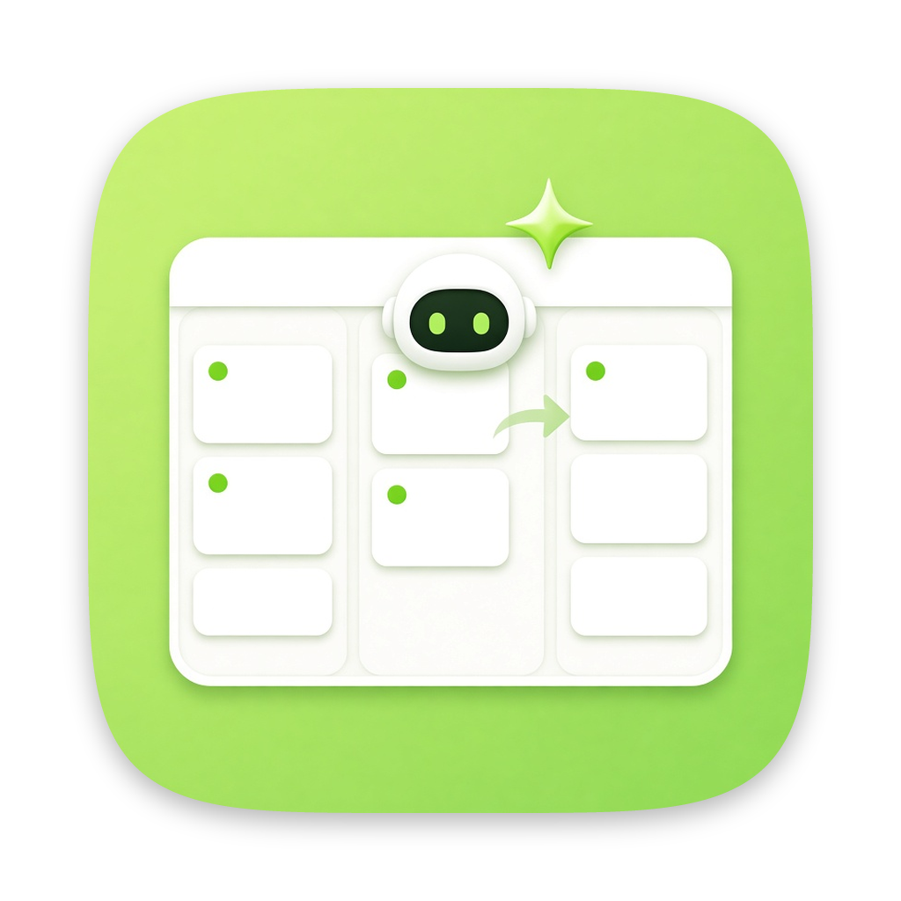
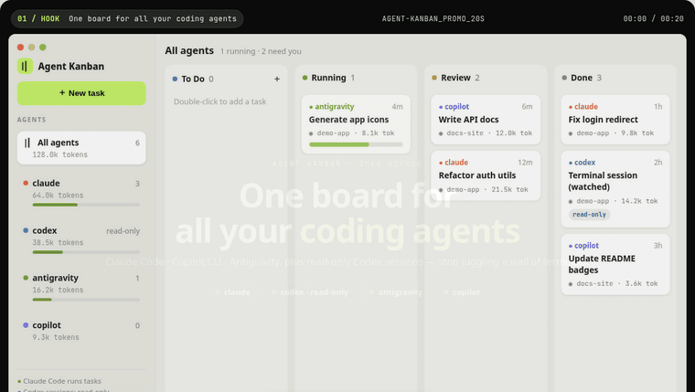

<p align="center">
  
</p>

<h1 align="center">Agent Kanban</h1>

<p align="center">
  <b>One board for all your coding agents.</b><br>
  <a href="https://agent-kanban.lzhgus.com">Website</a> ·
  <a href="https://agent-kanban.lzhgus.com/demo/">Live demo</a> ·
  <a href="#download">Download</a> ·
  <a href="#getting-started">Getting started</a><br>
  <b>English</b> · <a href="README.zh-CN.md">简体中文</a>
</p>

<p align="center">
  <a href="https://github.com/lzhgus/agent-kanban/releases/latest"></a>
  <a href="LICENSE"></a>
  <a href="https://awesomemygo.dev/apps/agent-kanban"></a>
</p>

<p align="center">
  <a href="https://agent-kanban.lzhgus.com">
    
  </a>
  <br>
  <sub>20-second promo (mocked data). <a href="site/media/promo-en.mp4">MP4 version</a> · <a href="https://agent-kanban.lzhgus.com/demo/">interactive version</a></sub>
</p>

Agent Kanban is a desktop app that runs Claude Code, GitHub Copilot CLI,
Antigravity, Grok Build, Pi, Kimi Code and OpenCode as tasks on a kanban
board. Each task works on its own git branch. Agents can plan before they
build, review each other's work, ask you questions and file tasks for one
another, and you see every agent's progress, token usage and plan quota in
one place.

It drives the CLIs you have installed and signed in to, so it uses your
existing subscriptions: no API keys, no account, no server. Everything runs on
your machine.

> **Status: early.** It works day to day with Claude Code. Support for the
> other agents is implemented and being tested. Expect rough edges.

## Download

**[Download the latest release](https://github.com/lzhgus/agent-kanban/releases/latest)** for macOS: a signed and
notarized universal app (Apple Silicon and Intel) for macOS 12 or newer,
about 10 MB. The current version is
[`agent-kanban-0.1.2.dmg`](https://github.com/lzhgus/agent-kanban/releases/download/v0.1.2/agent-kanban-0.1.2.dmg).

1. Open the DMG and drag **Agent Kanban** to Applications.
2. Open it from Applications, the Dock or Spotlight.

You still need git and at least one of the [agent CLIs](#supported-agents)
it supports, installed and signed in. You don't need Go unless you
[build from source](#build-from-source).

## What it does

- **Tasks are conversations.** Start a task, then reply to it to ask for
  changes: the agent picks up where it stopped, in the same session.
- **Talk to it while it works.** Type into a running task: Claude Code,
  Grok Build and Pi read your message at their next step, in the same turn;
  other agents get it when their turn ends.
- **A branch per task.** In a git repository, every task works in its own
  worktree on a `kanban/<id>-<title>` branch, so agents never touch your
  checkout or each other's files. Each turn ends in a commit, the Changes tab
  shows the diff, and **Merge** brings it into your branch when you are ready.
  Hover a change in the diff and click **Revert** to take just that change
  off the branch.
- **Plan first.** A task can start with a read-only planning turn. The plan
  waits for you to confirm or revise it before any code changes.
- **AI review.** At a plan or at finished changes, have another agent review.
  The task's agent revises, and the loop runs until the reviewer approves or
  the rounds you chose run out. The decision stays yours.
- **Agents work together.** A built-in MCP server lets an agent hand part
  of its task to another agent as a subtask, on a branch of its own branch
  and with no plan to confirm, then wait for it (`wait_todo`), message it
  while it works or ask it for more (`message_todo`), and merge its branch.
  Tick **Lead** on a new task to have its agent split the work this way.
  Agents can also ask you a question (`ask_user`), file follow-up tasks
  (`create_todo`), show what they are doing on their card (`report_status`),
  and read the board (`list_todos`, `get_todo`).
- **It tells you when it needs you.** A task that stops at a plan, a
  question, finished work or an error is marked until you open it. The Dock
  badge and the menu bar icon count them, a notification names each while
  the app is in the background, and ⌘J opens the next. The menu bar icon's
  menu opens any of them, or a new task.
- **Schedules.** Set **Repeat** on a new task (every hour, every day,
  weekdays or every week, at a time you choose) and it runs on that
  timetable, each run a new task on its own branch. A run missed while the
  app was closed happens once when it opens.
- **Survives a restart.** Quit the app in the middle of a turn, and when it
  opens again the agent resumes its conversation where it was.
- **Undo a turn.** Took a wrong turn? **Undo turn** puts the task's branch
  back as it was before the last turn and takes that turn out of Claude
  Code's conversation. What the agent did outside the worktree stays.
- **Use the board from your terminal.** Click **Use from your terminal** to
  copy a `claude mcp add` command: then Claude Code in any terminal can file
  tasks on the board, wait for them and message them.
- **Take over a terminal session.** Open a Claude Code session the board is
  watching and click **Continue on the board**: your replies resume it, in
  its folder.
- **Usage at a glance.** Tokens and cost per task and per agent, and each
  agent's plan windows (Claude's 5-hour and weekly limits, Copilot's premium
  requests, and so on) with when they reset.
- **Queue.** Choose how many agents run at once; the rest wait their turn.
- **Auto pickup.** Double-click the To Do column to jot down a task for an
  agent, or for **any** agent. Turn on **Auto** and free agents take To Do
  tasks first come, first served, one at a time each; a task for any agent
  goes to the free one with the most quota left. Tasks an agent filed
  always plan first and wait for you to confirm.
- **Sessions outside the board.** Claude Code, Codex and Antigravity sessions
  you run in a terminal show up on the board too, read-only, with their token
  usage where the agent records it.

## Supported agents

| Agent | Run tasks | Board tools (MCP) | Quota |
|---|---|---|---|
| [Claude Code](https://docs.anthropic.com/en/docs/claude-code) | ✅ | ✅ | ✅ |
| [GitHub Copilot CLI](https://github.com/github/copilot-cli) | 🧪 | 🧪 | 🧪 |
| Antigravity CLI (`agy`) | 🧪 | — | 🧪 |
| Grok Build (`grok`) | ✅ | ✅ | ✅ |
| [Pi](https://pi.dev) (`pi`) | ✅ | ✅ | — |
| Kimi Code (`kimi`) | ✅ | ✅ | — |
| [OpenCode](https://opencode.ai) (`opencode`) | ✅ | ✅ | — |
| [Codex](https://github.com/openai/codex) | watched read-only | — | ✅ |

✅ tested · 🧪 implemented, being tested

Grok Build, Pi, Kimi Code and OpenCode run with config of the board's own:
they share your sign-in, providers and default model, but not your rules,
hooks, plugins, extensions or MCP servers. Their tokens are counted per task;
only Grok Build has a plan quota to show.

## Getting started

[Download](#download) and open the app, then click **New task**, describe
what to do, pick an agent and a folder, and press **Add & Run**. Tick
**Plan first** to review a plan before the agent changes anything.

Opened from Finder, it reads your login shell's `PATH` to find the agent
CLIs.

### Build from source

Prefer to run it from source? You need macOS, [Go](https://go.dev/dl/)
1.27.3 or newer, git, and at least one of the agent CLIs above, installed
and signed in.

```sh
git clone https://github.com/lzhgus/agent-kanban.git
cd agent-kanban
go run .
```

### Build the app

To build your own app bundle instead of using the release DMG:

```sh
go run github.com/egoist/mygo/cmd/mygo build -skip-dmg
cp -R "build/darwin-arm64/Agent Kanban.app" /Applications/
```

The app icon is `assets/icon.png` (set as `icon` in `mygo.json`); replace that
file, or point `icon` at `assets/icon-alt-cream.png`, and rebuild to swap it.

The app and `go run .` share the same board.

Linux should work but is untested. Windows is not supported yet.

## How a task flows

```
To Do ─▶ Running ─▶ Review ─▶ Done
To Do ─▶ Running (plan) ─▶ Confirm ─▶ Running ─▶ Review ─▶ Done    with Plan first
```

- **To Do**: filed, not started (or waiting for a free agent, with Auto on).
- **Running**: an agent is working (or **Queued**, waiting for a free slot).
- **Confirm**: a plan, or an agent's question, waits for you.
- **Review**: the turn is done; reply, review, merge, or hand it off.
- **Done**: finished. Agents' sessions you run outside the board move here
  after two idle hours.

## Good to know

- **Agents run unattended.** Each agent runs headless with its permission
  prompts turned off, inside the task's worktree (or the folder itself when
  it is not a git repository). Only point it at code you trust them with.
- **Planning and reviewing are read-only.** Whatever a planning or review turn
  leaves behind is reset when it ends.
- **The MCP server is local.** It listens on `127.0.0.1` only, and each turn
  gets its own URL that stops working when the turn ends.
- **Where things live.** The board is saved in
  `~/Library/Application Support/agent-kanban/board.json`, worktrees next to
  it in `worktrees/`. Deleting a task removes its worktree but keeps its
  branch in your repository.

## Development

```sh
go test ./...
go vet ./...
```

End-to-end checks against the real Claude Code CLI (they use a little of
your plan; `EVAL_MODEL` picks the model, haiku by default):

```sh
go test -tags eval -run TestEval -v -timeout 20m
```

Built with [MyGo](https://github.com/egoist/mygo), which draws the native UI
in pure Go.

## Website

The landing page at [agent-kanban.lzhgus.com](https://agent-kanban.lzhgus.com)
lives in [`site/`](site): plain HTML, CSS and a few lines of JS. The English
and Chinese pages are generated from one template:

```sh
python3 scripts/build-site.py   # writes site/index.html and site/zh/index.html
```

It is served as-is by Cloudflare Pages; there is no build step.

## License

[MIT](LICENSE)
