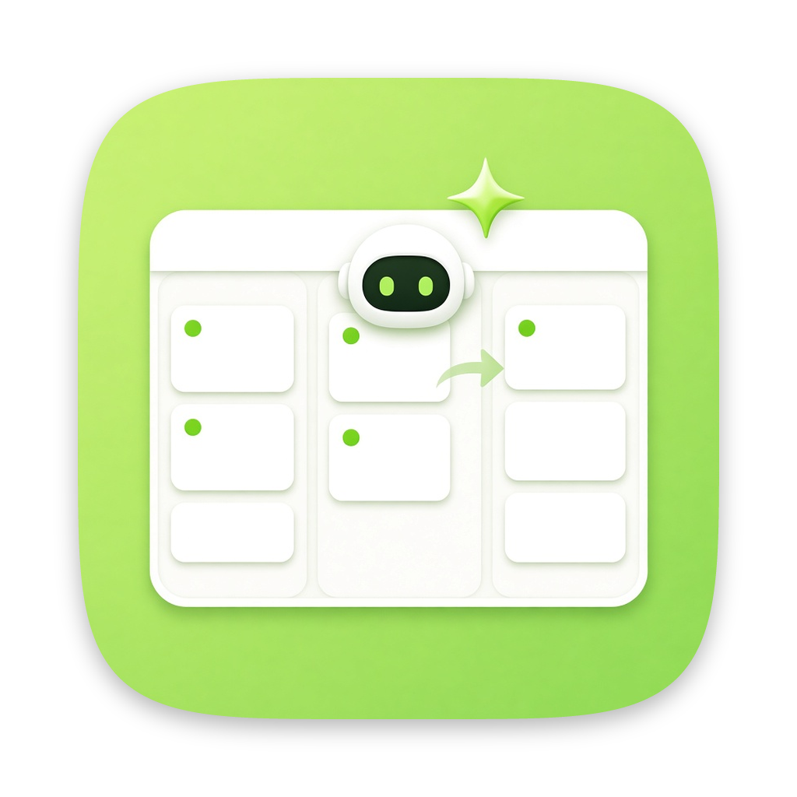
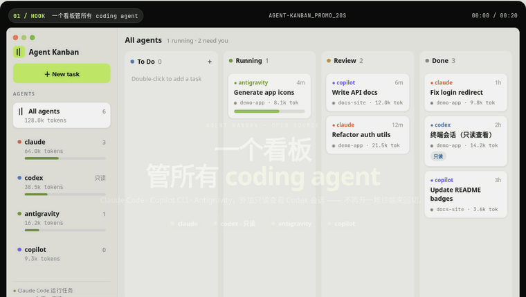

<p align="center">
  
</p>

<h1 align="center">Agent Kanban</h1>

<p align="center">
  <b>一个看板管所有 coding agent。</b><br>
  <a href="https://agent-kanban.lzhgus.com/zh/">官网</a> ·
  <a href="https://agent-kanban.lzhgus.com/zh/demo/">在线演示</a> ·
  <a href="#下载">下载</a> ·
  <a href="#开始使用">开始使用</a><br>
  <a href="README.md">English</a> · <b>简体中文</b>
</p>

<p align="center">
  <a href="https://github.com/lzhgus/agent-kanban/releases/latest"></a>
  <a href="LICENSE"></a>
  <a href="https://awesomemygo.dev/apps/agent-kanban"></a>
</p>

<p align="center">
  <a href="https://agent-kanban.lzhgus.com/zh/">
    
  </a>
  <br>
  <sub>20 秒宣传动画（模拟数据）。<a href="site/media/promo-zh.mp4">MP4 版本</a> · <a href="https://agent-kanban.lzhgus.com/zh/demo/">交互版本</a></sub>
</p>

Agent Kanban 是一个桌面应用，把 Claude Code、GitHub Copilot CLI、Antigravity、
Grok Build、Pi、Kimi Code 和 OpenCode 当作看板上的任务来运行。每个任务在自己的
git 分支上工作。agent 可以先计划再动手、互相审查对方的工作、向你提问、互相创建任务；
每个 agent 的进度、token 用量和套餐额度都能在一个地方看到。

它驱动的是你已经安装并登录的 CLI，所以用的就是你现有的订阅：不需要 API key，
不需要账号，没有服务器。一切都在你的电脑上运行。

> **状态：早期版本。** 日常配合 Claude Code 使用没有问题。其他 agent 的支持
> 已经实现，正在测试中。难免有粗糙的地方。

## 下载

**[下载最新版本](https://github.com/lzhgus/agent-kanban/releases/latest)**（macOS）：已签名并经 Apple 公证的通用版应用，
同时支持 Apple Silicon 和 Intel 芯片，需要 macOS 12 或更新版本，大小约 10 MB。
当前版本是 [`agent-kanban-0.1.3.dmg`](https://github.com/lzhgus/agent-kanban/releases/download/v0.1.3/agent-kanban-0.1.3.dmg)。

1. 打开 DMG，把 **Agent Kanban** 拖进“应用程序”文件夹。
2. 从“应用程序”、Dock 或 Spotlight 打开。

你仍然需要 git，以及至少一个它支持的 [agent CLI](#支持的-agent)（已安装并登录）。
除非[从源码构建](#从源码构建)，否则不需要安装 Go。

## 功能

- **任务就是对话。** 开始一个任务，之后回复它来要求修改：agent 会在同一个会话里
  从上次停下的地方继续。
- **干活时也能插话。** 在运行中的任务里直接输入：Claude Code、Grok Build 和 Pi
  会在下一步就读到，在同一轮里一并处理；其他 agent 在这一轮结束后收到。
- **每个任务一个分支。** 在 git 仓库中，每个任务都在自己的 worktree 里、
  `kanban/<id>-<title>` 分支上工作，所以 agent 永远不会碰你的工作区，也不会碰彼此的文件。
  每一轮都以一次 commit 结束，Changes 标签页显示 diff，准备好之后点 **Merge**
  把它合并进你的分支。鼠标移到 diff 里的某处改动上，点 **Revert**，
  就只把这一处改动从分支上撤掉。
- **先计划。** 任务可以从一轮只读的计划开始。计划会等你确认或修改之后，才会改动任何代码。
- **AI 审查。** 在计划阶段或改动完成后，可以让另一个 agent 来审查。任务的 agent 根据意见修改，
  循环进行，直到审查者通过或你设定的轮数用完。最终决定权在你。
- **agent 之间协作。** 内置的 MCP 服务器让 agent 可以把自己任务的一部分作为子任务
  交给另一个 agent：子任务在它分支的一个新分支上工作，不需要确认计划；之后可以等它完成
  （`wait_todo`）、在它工作时发消息或之后追问（`message_todo`），再把它的分支合并进来。
  新建任务时勾选 **Lead**，它的 agent 就会这样拆分工作。agent 还可以向你提问
  （`ask_user`）、创建后续任务（`create_todo`）、在卡片上显示自己在做什么
  （`report_status`）、读取看板（`list_todos`、`get_todo`）。
- **需要你时会告诉你。** 停在计划、提问、完成的工作或错误上的任务会一直标记，直到你打开它。
  Dock 角标和菜单栏图标显示数量，应用在后台时会发通知，⌘J 打开下一个。
  菜单栏图标的菜单可以直接打开其中任意一个，或新建任务。
- **定时任务。** 新建任务时设置 **Repeat**（每小时、每天、工作日或每周，时间自选），
  它就会按时运行，每次运行都是一个新任务、在自己的分支上。应用关闭期间错过的运行，
  会在下次打开时补跑一次。
- **重启不中断。** 一轮还没跑完就退出应用，再打开时 agent 会接着原来的会话继续。
- **撤销一轮。** 跑偏了？**Undo turn** 会把任务的分支恢复到上一轮之前，并把这一轮从
  Claude Code 的对话里拿掉。agent 在 worktree 之外做的事不会撤销。
- **在终端里使用看板。** 点 **Use from your terminal** 复制一条 `claude mcp add` 命令，
  之后任何终端里的 Claude Code 都能往看板派任务、等它完成、给它发消息。
- **接管终端会话。** 打开看板正在监控的 Claude Code 会话，点 **Continue on the board**：
  你的回复会在它原来的文件夹里续接这个会话。
- **用量一目了然。** 按任务、按 agent 统计 token 和费用，以及每个 agent 的套餐窗口
  （Claude 的 5 小时和每周限额、Copilot 的 premium requests 等）和重置时间。
- **排队。** 选择同时运行几个 agent，其余的排队等候。
- **自动领取。** 双击 To Do 列，就能给某个 agent（或**任意** agent）快速记下一个任务。
  打开 **Auto** 后，空闲的 agent 会按先来先得的顺序领取 To Do 任务，每个 agent 一次一个；
  指定给任意 agent 的任务会交给剩余额度最多的那个空闲 agent。由 agent 创建的任务
  总是先做计划，并等待你确认。
- **看板之外的会话。** 你在终端里运行的 Claude Code、Codex、Antigravity 和 Grok Build
  会话也会出现在看板上（只读），能看到它们在做什么；只要 agent 有记录，就会显示
  token 用量。

## 支持的 agent

| Agent | 运行任务 | 看板工具（MCP） | 额度 |
|---|---|---|---|
| [Claude Code](https://docs.anthropic.com/en/docs/claude-code) | ✅ | ✅ | ✅ |
| [GitHub Copilot CLI](https://github.com/github/copilot-cli) | 🧪 | 🧪 | 🧪 |
| Antigravity CLI（`agy`） | 🧪 | — | 🧪 |
| Grok Build（`grok`） | ✅ | ✅ | ✅ |
| [Pi](https://pi.dev)（`pi`） | ✅ | ✅ | — |
| Kimi Code（`kimi`） | ✅ | ✅ | — |
| [OpenCode](https://opencode.ai)（`opencode`） | ✅ | ✅ | — |
| [Codex](https://github.com/openai/codex) | 只读查看 | — | ✅ |

✅ 已测试 · 🧪 已实现，测试中

Grok Build、Pi、Kimi Code 和 OpenCode 运行时使用看板自己的配置：共用你的登录、
模型服务商和默认模型，但不加载你的规则、hooks、插件、扩展和 MCP 服务器。它们的 token
按任务统计；目前只有 Grok Build 能显示套餐额度。

## 开始使用

[下载](#下载)并打开应用，点击 **New task**，描述要做什么，选择 agent 和文件夹，
然后点 **Add & Run**。勾选 **Plan first**，可以在 agent 改动任何东西之前先审阅它的计划。

从 Finder 打开时，它会读取你登录 shell 的 `PATH` 来找到各个 agent CLI。

### 从源码构建

想从源码运行？你需要 macOS、[Go](https://go.dev/dl/) 1.27.3 或更新版本、git，
以及至少一个上面列出的 agent CLI（已安装并登录）。

```sh
git clone https://github.com/lzhgus/agent-kanban.git
cd agent-kanban
go run .
```

### 构建应用

想自己构建应用包、而不是用发布版 DMG：

```sh
go run github.com/egoist/mygo/cmd/mygo build -skip-dmg
cp -R "build/darwin-arm64/Agent Kanban.app" /Applications/
```

应用图标是 `assets/icon.png`（在 `mygo.json` 中设为 `icon`）；替换这个文件，
或把 `icon` 指向 `assets/icon-alt-cream.png`，然后重新构建即可更换。

应用和 `go run .` 共用同一个看板。

Linux 应该可以运行，但未经测试。暂不支持 Windows。

## 任务流程

```
To Do ─▶ Running ─▶ Review ─▶ Done
To Do ─▶ Running (plan) ─▶ Confirm ─▶ Running ─▶ Review ─▶ Done    开启 Plan first 时
```

- **To Do**：已创建，尚未开始（或在 Auto 模式下等待空闲的 agent）。
- **Running**：有 agent 正在工作（或处于 **Queued**，等待空位）。
- **Confirm**：一份计划或 agent 的提问在等你处理。
- **Review**：这一轮已完成；可以回复、审查、合并，或转交给别的 agent。
- **Done**：已完成。你在看板之外运行的 agent 会话，空闲两小时后会移到这里。

## 须知

- **agent 无人值守运行。** 每个 agent 都以无头模式运行，并关闭了权限确认，
  工作范围在任务的 worktree 内（文件夹不是 git 仓库时，就是文件夹本身）。
  只让它们处理你信得过的代码。
- **计划和审查是只读的。** 计划或审查轮次留下的任何改动，都会在这一轮结束时被重置。
- **MCP 服务器只在本地。** 它只监听 `127.0.0.1`，每一轮都有自己的 URL，
  这一轮结束后即失效。
- **数据存放位置。** 看板保存在
  `~/Library/Application Support/agent-kanban/board.json`，worktree 在它旁边的
  `worktrees/` 目录里。删除任务会删除它的 worktree，但保留它在你仓库里的分支。

## 开发

```sh
go test ./...
go vet ./...
```

用真实的 Claude Code CLI 做端到端检查（会用掉一点你的套餐额度；`EVAL_MODEL` 指定模型，
默认 haiku）：

```sh
go test -tags eval -run TestEval -v -timeout 20m
```

基于 [MyGo](https://github.com/egoist/mygo) 构建，它用纯 Go 绘制原生界面。

## 官网

[agent-kanban.lzhgus.com](https://agent-kanban.lzhgus.com/zh/) 的落地页位于
[`site/`](site) 目录：纯 HTML、CSS 和几行 JS。英文和中文页面由同一个模板生成：

```sh
python3 scripts/build-site.py   # 生成 site/index.html 和 site/zh/index.html
```

站点由 Cloudflare Pages 原样托管，不需要构建步骤。

## 许可证

[MIT](LICENSE)
